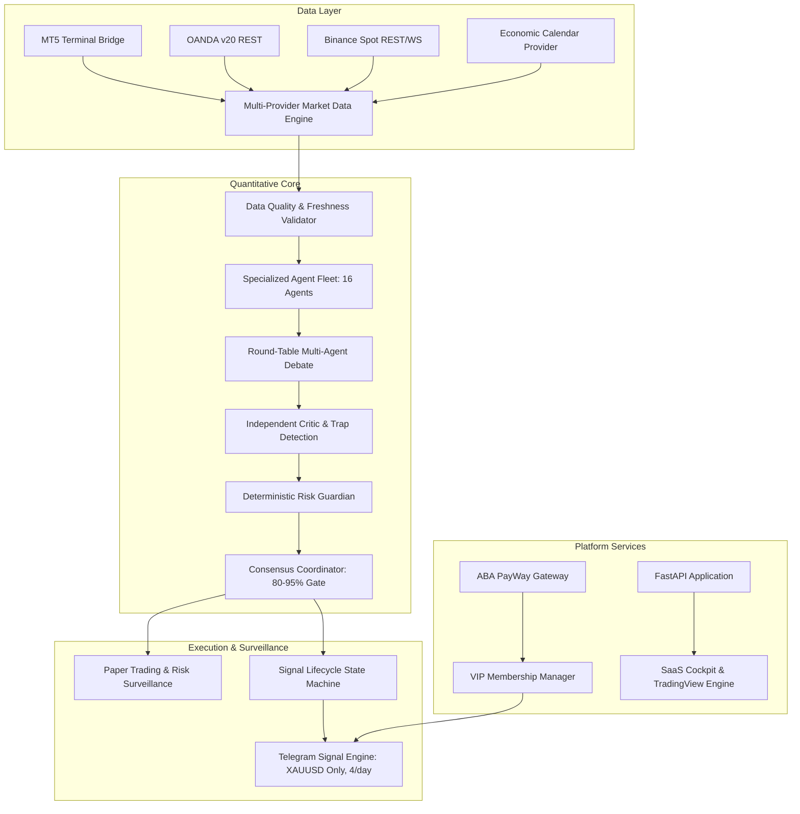
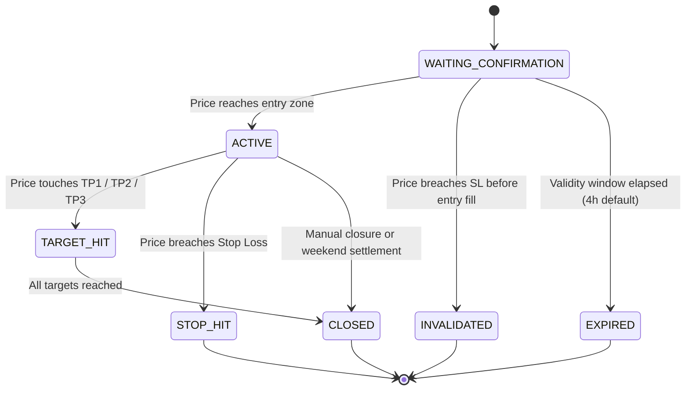
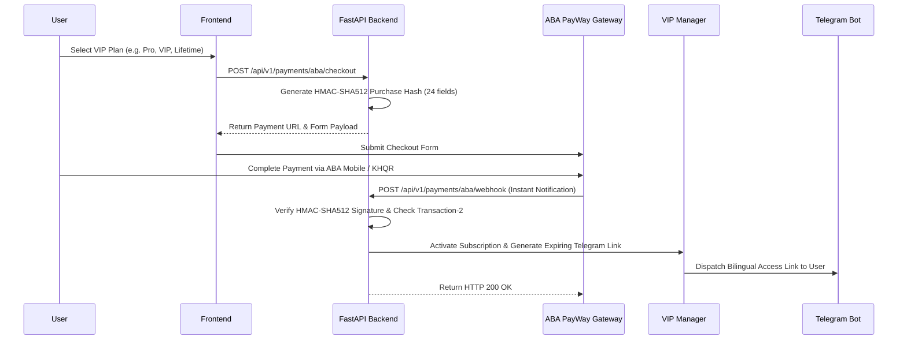

# ZYROX AI — System Architecture & Data Flow

## 1. High-Level Architecture Overview

ZYROX AI is architected into layered, modular subsystems designed for high concurrency, zero lookahead bias, strict data verification, and deterministic risk management.

---

## 2. Multi-Agent Orchestration & Consensus Flow

1. **Snapshot Isolation:** A single historical candle snapshot spanning `W1`, `D1`, `H4`, `H1`, `M15`, and `M5` is captured simultaneously.
2. **Specialist Evaluation:** Technical, ICT/SMC, Macro, and Quantitative specialists evaluate the market snapshot in parallel without cross-talk or bias leakage.
3. **Round-Table Debate:** The agents submit structured claims and debate market structure, order flow alignment, and liquidity dynamics.
4. **Independent Critic Audit:** An adversarial critic actively attempts to invalidate the trade idea by checking for overbought/oversold exhaustion traps, high-impact news windows, and liquidity grabs.
5. **Deterministic Risk Guardian:**
   - Enforces minimum Risk-to-Reward ratio ($\ge 1:2.0$).
   - Caps risk at $0.5\%$ of account equity.
   - Computes exact position size: $\text{Lots} = \frac{\text{Equity} \times 0.005}{\text{Stop Distance} \times \text{Contract Size}}$.
   - Verifies spread cost ($\le 20\%$ of stop distance).
6. **Consensus Score Gate:** Synthesizes confluence into an institutional score. Only setups scoring between $80\%$ and $95\%$ are approved.

---

## 3. Signal Lifecycle State Machine

Signals transition through an explicit, persistent finite state machine with database audit logging:

---

## 4. Payment & Subscription Architecture (ABA PayWay)

---

## 5. Security & Isolation Boundaries

- **Zero Secret Exposure:** API keys, webhook secrets, database credentials, and bot tokens are strictly isolated in environment variables. Redaction filters scrub sensitive tokens from all logs.
- **Constant-Time Cryptography:** All API token comparisons, HMAC verifications, and webhook authentication checks utilize `hmac.compare_digest` to prevent timing attacks.
- **Replay Attack Defense:** MT5 bridge requests require timestamp headers within $\pm 60\text{ seconds}$ and cache request signatures for $120\text{ seconds}$.
- **Shadow Mode Invariant:** Automated live broker order placement is strictly disabled at the source code level to safeguard user capital.

