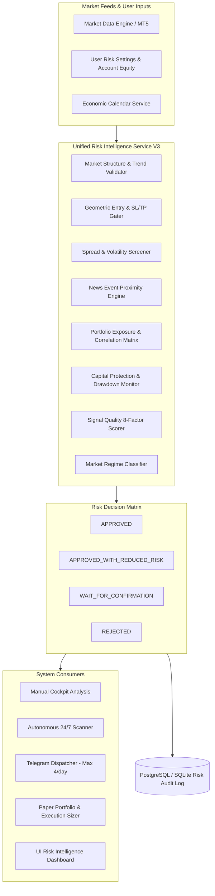

# ZYROX AI — Advanced Risk Intelligence V3: Repository Audit & Architecture Baseline
**Date:** November 2026  
**System:** ZYROX AI Multi-Market Quantitative & Autonomous Risk Platform  
**Target:** Production (`https://taikry-ai-trading.onrender.com/dashboard/`)  
**Repository:** `https://github.com/Taikry/Taikry-AI-Trading`  

---

## 1. Executive Summary

This audit establishes the source-of-truth baseline for **ZYROX AI Advanced Risk Intelligence V3**. The existing system is a production-grade FastAPI application backed by SQLite/PostgreSQL, featuring a 16-agent multi-agent architecture, real-data market pipelines (Yahoo Finance fallback, Binance public crypto, Windows MT5 Bridge), and an interactive web dashboard.

All new V3 risk intelligence capabilities will be introduced as an evolutionary, modular upgrade under `taikry/risk/` and integrated directly into the existing multi-agent consensus, market scanner, paper portfolio, and UI without breaking existing database tables, API contracts, or the 337+ passing tests.

---

## 2. Existing Architecture Audit

### 2.1 Backend Framework & Services
- **Framework:** FastAPI (`taikry/api/app.py`, `taikry/api/routes.py`) with 89+ REST endpoints.
- **ORM & Database:** SQLAlchemy with SQLite locally (`taikry_market.db`) and PostgreSQL in production (`DATABASE_URL`).
- **Migrations:** Versioned migrations tracked via `system_versioned_migrations` (`taikry/database/versioned_migrations.py`).
- **Authentication & SaaS:** JWT session management, bcrypt password hashing, 14-day free trial entitlement, and ABA PayWay eCommerce integration.

### 2.2 Multi-Agent Architecture (`taikry/agents/`)
The system contains specialized agent modules registered in `AgentRegistry` (`taikry/agents/registry.py`):
1. `data_quality_agent.py` — Feed freshness, staleness bounds (180s), synthetic candle rejection.
2. `technical_analyst.py` — Deterministic indicators (EMA 9/21/50/200, RSI 14, MACD, ATR).
3. `ict_smc_analyst.py` — Order Blocks, Fair Value Gaps (FVGs), liquidity sweeps, Break of Structure (BOS), Change of Character (CHOCH).
4. `macro_analyst.py` — DXY dollar strength index, yield curves, central bank interest rate stance.
5. `orderflow_sentiment_analyst.py` — Order flow proxy, volume profile, sentiment divergence.
6. `fractal_mtf_analyst.py` — Multi-timeframe trend alignment (W1, D1, H4, H1, M15, M5).
7. `regime_detection_agent.py` — Hurst exponent, ADX, Bollinger Band width, volatility state.
8. `quantitative_research_agent.py` — Statistical edge, variance, probability distributions.
9. `ml_forecast_agent.py` — Vectorized price direction and momentum forecasts.
10. `concept_recommender.py` — Strategy formulation and candidate setup generation.
11. `risk_validator.py` — Independent Risk Auditor (Gatekeeper) enforcing R:R, spread, and position sizing.
12. `counter_analysis_agent.py` — Devil's advocate, trapped trader identification, contrarian risks.
13. `consensus_engine.py` — Weighted consensus synthesis, 8-agent voting quorum, veto rules.
14. `debate_engine.py` — Adversarial conversational agent debates.
15. `portfolio_analysis_agent.py` — Open trade count, capital allocation, maximum portfolio risk cap.
16. `execution_simulation_agent.py` — Slippage modeling, spread costs, execution feasibility.

### 2.3 Market Data Providers (`taikry/data/`)
- `providers.py` (`market_data_engine`): Fetches multi-timeframe OHLCV candles, verified prices, and bid/ask quotes.
- `mt5_receiver.py`: Windows MT5 Desktop Bridge receiving broker-grade ticks, spreads, and execution constraints.
- `validator.py`: Strict data validation ensuring no synthetic or zero-volume candles are treated as executable signals.
- `economic_calendar.py`: FairEconomy & ForexFactory calendar feed parser with high-impact news blackout detection.

### 2.4 Existing Risk Management System
- `RiskValidatorAgent` (`taikry/agents/risk_validator.py`): Evaluates R:R floor, ATR stop distances, spread costs (max 20% of stop distance), simultaneous positions limit (max 3), and news blackouts.
- `RiskGuardian` (`taikry/agents/orchestration_layer.py`): Deterministic sizing arithmetic, SL/TP geometry validation.
- Selectable Risk Profiles: `CONSERVATIVE`, `BALANCED`, `AGGRESSIVE`, `CUSTOM`.

### 2.5 Telegram Services & Signal Policy
- Maximum **4 signals per day** strictly for **XAUUSD (Gold)** with **80%–95% AI confidence score**.
- Lifecycle updates (TP hit, SL moved to BE) silenced by default to prevent notification fatigue.
- Interactive Telegram Bot (`/start`, `/status`, `/signal`, `/upgrade`) and Mini App.

---

## 3. Gaps Identified for Advanced Risk Intelligence V3

| Area | Current Implementation | V3 Target Upgrade |
| :--- | :--- | :--- |
| **Decisions** | Binary `APPROVE` / `REJECT` / `WAIT` | 4 Standard Decisions: `APPROVED`, `APPROVED_WITH_REDUCED_RISK`, `WAIT_FOR_CONFIRMATION`, `REJECTED`. |
| **Service Integration** | Logic split across `risk_validator.py` and `orchestration_layer.py` | One unified backend Risk Intelligence service (`taikry/risk/service.py`) called by manual analysis, scanner, agents, telegram, calculator, and portfolio. |
| **Portfolio Intelligence** | Simple open position count & 5% cap | Deep multi-market portfolio matrix: currency exposure, asset class exposure, correlation matrix, aggregate stop-loss risk, drawdown monitoring, and concentration warnings. |
| **Market Regime** | 4 informal states (`CONSOLIDATION_RANGE`, `TRENDING_BULLISH`, `TRENDING_BEARISH`, `CHOPPY_ROTATION`) | 8 Standard States: `STRONG_TREND`, `WEAK_TREND`, `RANGE`, `HIGH_VOLATILITY`, `LOW_VOLATILITY`, `BREAKOUT`, `REVERSAL`, `UNCERTAIN` with explicit supporting indicators. |
| **News Risk Engine** | Binary 30-min blackout boolean | Structured calendar-aware service with pre/post-event windows, affected currency/symbol mappings, and explicit stale/unavailable disclaimers. |
| **Signal Quality Score** | Single heuristic consensus score | Explainable 0–100 score deconstructed into 8 distinct factors (Trend, Structure, Momentum, Volatility, Entry, R:R, News, Data). |
| **Capital Protection** | Single per-trade risk % and max positions | Multi-tier limits: Daily loss limit, Weekly loss limit, Monthly loss limit, Maximum drawdown, Correlated exposure limits with hard lockouts. |
| **Adaptive Learning** | Weight updates in `AgentLearningModel` | Shadow testing, recurring error detection, parameter recommendations, and pre-defined out-of-sample promotion gates. |
| **Performance Intelligence** | Basic PnL sum in `PaperTrade` | Comprehensive metrics: Win rate, Profit factor, Expectancy, Average R, Max drawdown, segregated by instrument, timeframe, strategy, and agent. |
| **Persistence** | Individual setup results | Persistent `RiskAssessmentLog` and `UserRiskSettings` models in database with full audit trails. |

---

## 4. Architectural Implementation Strategy

---

## 5. Non-Negotiable Safety Commitments
1. **No guaranteed profit or win rate claims**: Signal score is strictly an internal confluence measure.
2. **No fabricated quotes or phantom candles**: Live or fallback verified pricing only.
3. **No automatic live broker execution**: Paper simulated trades only.
4. **No autonomous increase of user risk limits**: Risk caps can only be changed by explicit user action.
5. **Strict Telegram Quota**: Max 4 signals per day, XAUUSD only, 80–95% AI score, lifecycle noise suppressed.
6. **Risk Manager Veto Authority**: Any risk violation halts signal generation immediately.

