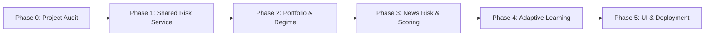

# ZYROX AI — Advanced Risk Intelligence V3: Implementation Plan

**System:** ZYROX AI Autonomous Multi-Market Risk & Decision Engine  
**Release Target:** v3.0.0  
**Status:** In Progress — Phase 0 Complete  

---

## Roadmap & Phase Breakdown

---

## Phase 1: Unified Shared Risk Intelligence Service (`taikry/risk/`)

### Objectives
Create a single, authoritative Risk Intelligence Service (`taikry/risk/service.py`) that acts as the sole risk evaluator across the platform.

### Deliverables
1. **`taikry/risk/models.py`**:
   - `RiskDecision` Enum: `APPROVED`, `APPROVED_WITH_REDUCED_RISK`, `WAIT_FOR_CONFIRMATION`, `REJECTED`.
   - `RiskAssessmentResult` Pydantic model with detailed breakdown of all 9 validation checks.
   - `UserRiskProfileConfig` Pydantic model and SQLAlchemy ORM models (`UserRiskSettings`, `RiskAssessmentLog`).
2. **`taikry/risk/service.py` (`RiskIntelligenceService`)**:
   - `evaluate_trade_candidate(...)` method:
     1. Market structure and trend confirmation.
     2. Entry distance and stop-loss validity (geometry, ATR buffer).
     3. Risk-to-reward ratio check against user-selected profile.
     4. Spread and volatility limits (spread cost <= max % of stop distance).
     5. News event exposure check.
     6. Existing portfolio exposure check (aggregate risk % and position limits).
     7. Correlated positions check (e.g. max correlated USD or crypto exposure).
     8. Daily, weekly, and monthly loss limits check (drawdown circuit breaker).
     9. Signal confidence and data freshness verification.
   - Sizing calculations: lot sizing based on account equity and selected risk %.
   - Database persistence: Records every assessment into `RiskAssessmentLog` with UTC timestamps.
3. **Database Migration (`V006_risk_intelligence_v3.py`)**:
   - Creates `user_risk_settings` and `risk_assessment_logs` tables.
   - Registers in `system_versioned_migrations`.

---

## Phase 2: Multi-Market Portfolio Intelligence & Market Regime Engines

### Objectives
1. **Multi-Market Portfolio Engine (`taikry/risk/portfolio.py`)**:
   - Calculates total portfolio risk exposure across Forex, Metals, Crypto, and Indices.
   - Computes currency exposure (e.g., net USD long/short exposure).
   - Computes asset-class exposure (Commodities %, Crypto %, Forex %).
   - Generates pairwise correlation matrix for all active and proposed positions.
   - Monitors current drawdown against capital protection thresholds.
   - Issues concentration warnings when correlated positions exceed safety limits.
2. **Market Regime Engine (`taikry/risk/regime.py`)**:
   - Upgrades `regime_detection_agent.py` to classify market conditions into the 8 required states:
     - `STRONG_TREND` (Hurst > 0.60, ADX > 25, EMAs aligned)
     - `WEAK_TREND` (Hurst 0.52–0.60, ADX 18–25)
     - `RANGE` (Hurst < 0.45, ADX < 18, price oscillating between S/R)
     - `HIGH_VOLATILITY` (ATR / price > 90th percentile, BB width expanded)
     - `LOW_VOLATILITY` (BB squeeze, ATR compression)
     - `BREAKOUT` (Price outside 20-period Donchian/BB with volume spike)
     - `REVERSAL` (Exhaustion wick, RSI divergence, structural CHOCH)
     - `UNCERTAIN` (Insufficient bar depth or conflicting multi-timeframe readings)
   - Exposes supporting indicators, statistical metrics, and plain-English/Khmer evidence.

---

## Phase 3: News Risk Engine & Signal Quality Scoring

### Objectives
1. **News Risk Engine (`taikry/risk/news_risk.py`)**:
   - Calendar-aware risk evaluation for CPI, NFP, FOMC, PCE, GDP, and central bank speeches.
   - Returns event name, scheduled time (UTC & Asia/Phnom_Penh), affected currency, and impacted symbols.
   - Configurable pre-event (e.g. 15, 30, 60 mins) and post-event protection windows.
   - Explicit disclaimer and graceful fallback when calendar feeds are stale or unavailable.
2. **Signal Quality Scoring Engine (`taikry/risk/quality_scorer.py`)**:
   - Explainable 0–100 score built from 8 validated factors (each weighted with clear criteria):
     1. Trend alignment (0–15 pts)
     2. Market structure confirmation (0–15 pts)
     3. Momentum & RSI/MACD confluence (0–15 pts)
     4. Volatility suitability & ATR buffer (0–10 pts)
     5. Entry quality & proximity to support/resistance (0–15 pts)
     6. Risk-to-reward ratio (0–15 pts)
     7. News risk proximity (0–10 pts)
     8. Data freshness & quote fidelity (0–5 pts)
   - Disclaims clearly: *Internal setup quality metric, not a probability of profit or guarantee.*

---

## Phase 4: Adaptive AI Learning & Performance Analytics

### Objectives
1. **Adaptive Learning Engine (`taikry/risk/learning.py`)**:
   - Analyzes paper trading history and resolved signals.
   - Identifies recurring errors (e.g., entering during low-volatility chop or counter-trend rallies).
   - Generates parameter improvement recommendations.
   - Detects strategy degradation (falling win rate, deteriorating profit factor).
   - Runs shadow tests before promoting any weight adjustments.
   - **Safety Rule Enforced:** Never allows AI learning to autonomously raise user risk limits.
2. **Performance Intelligence Engine (`taikry/risk/performance.py`)**:
   - Calculates Win Rate, Profit Factor, Expectancy, Average R Multiple, Max Drawdown, Consecutive Wins/Losses.
   - Deconstructs results by Instrument, Timeframe, Strategy, and AI Agent.
   - Strictly segregates verified closed trades from hypothetical backtests and unverified signals.

---

## Phase 5: REST API, UI Workspace, Tests & Deployment

### Objectives
1. **REST API Endpoints (`taikry/api/routes.py`)**:
   - `GET /api/v1/risk/overview` — Current account risk, open risk, drawdown, capital limits.
   - `GET /api/v1/risk/portfolio` — Multi-market exposure, currency matrix, correlation matrix.
   - `GET /api/v1/risk/regime` — 8-state market regime analysis for any symbol.
   - `GET /api/v1/risk/news` — Calendar risk, upcoming high-impact events, active lockouts.
   - `GET /api/v1/risk/quality` — 8-factor score deconstruction.
   - `POST /api/v1/risk/evaluate-candidate` — Full unified risk assessment before signal or paper trade.
   - `GET /api/v1/risk/settings` & `PUT /api/v1/risk/settings` — User risk configurations.
   - `GET /api/v1/risk/performance` — Detailed performance analytics.
2. **UI Workspace (`taikry/web/`)**:
   - Modern dark charcoal theme with emerald accents and gold highlights for XAUUSD.
   - Risk Intelligence subpane with tabs:
     - Risk Overview & Capital Protection
     - Portfolio & Currency Exposure
     - Market Regime Matrix
     - News Risk Radar
     - Signal Quality Breakdown
     - Performance Analytics
   - Bilingual English & Khmer (`ភាសាខ្មែរ`) support.
3. **Comprehensive Test Suite (`tests/test_risk_intelligence_v3.py`)**:
   - Risk formulas, portfolio correlation, 8-state regime, news windows, quality scoring, and capital protection.
4. **Git & Render Production Deployment**:
   - Commit, push to `main` branch on GitHub, and verify HTTP 200 on Render Production.

