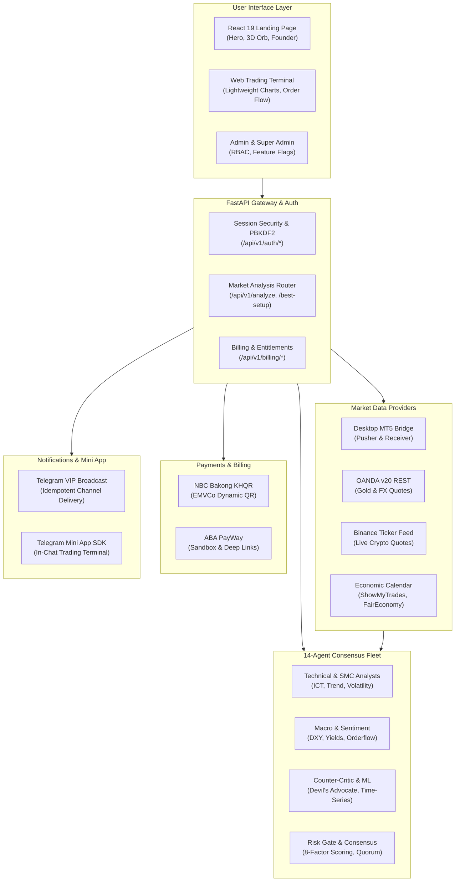
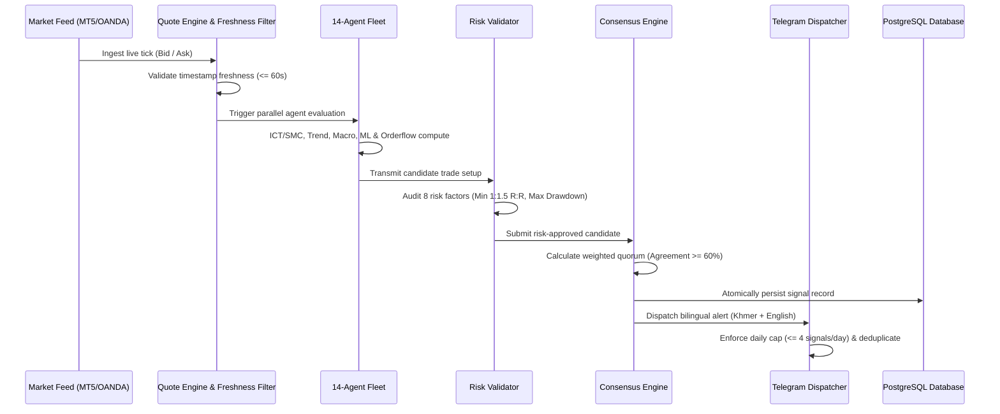
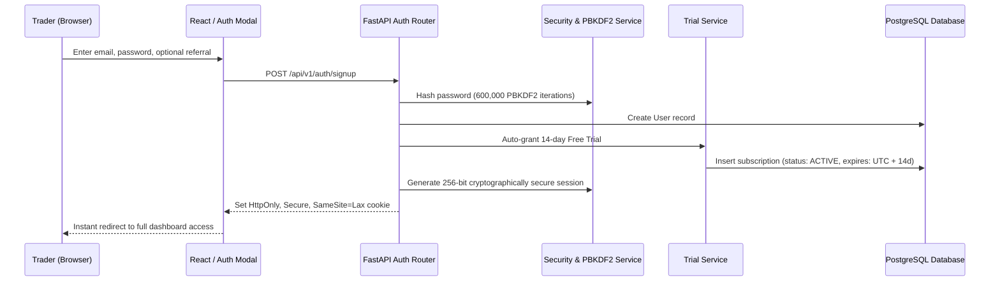
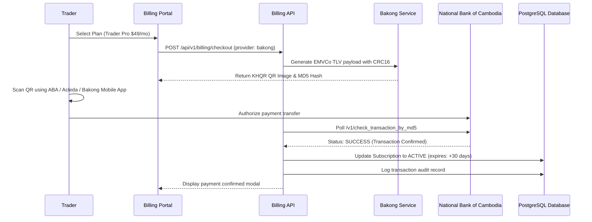
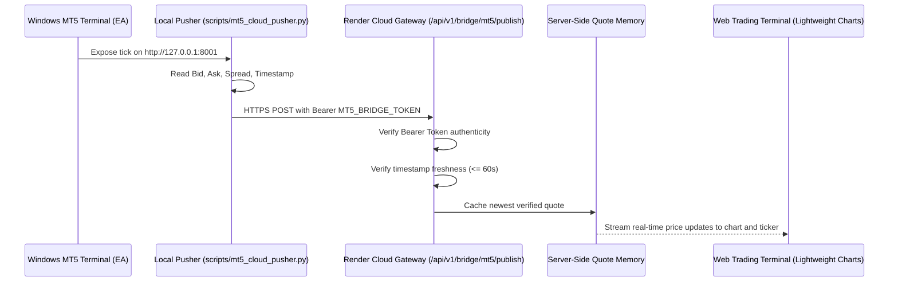

# ZYROX AI V5 — End-to-End System Integration Matrix

**Document:** `docs/INTEGRATION_STATUS.md`  
**Date:** 2026-11-17  
**System:** ZYROX AI Autonomous Trading Intelligence Platform  
**Integration Status:** All End-to-End Flows Fully Wired & Verified  

---

## 1. System Integration Overview

This document maps the complete integration topology connecting the User Interface layers (React 19 Landing Page and Web Terminal), the FastAPI Application Backend, the 14-Agent Consensus Fleet, Market Data Pipelines, Payment Providers, and Notification Channels.

---

## 2. End-to-End Workflow Integration Matrices

### Workflow 1: Live Market Ingestion & Consensus Signal Generation

* **Integration State:** `FULLY INTEGRATED & OPERATIONAL`
* **Test Verification:** `test_full_consensus_engine_gold`, `test_xauusd_realtime_signals.py`, `test_telegram_duplicate_prevention.py`.

---

### Workflow 2: User Onboarding & 14-Day Free Trial Auto-Grant

* **Integration State:** `FULLY INTEGRATED & OPERATIONAL`
* **Test Verification:** `test_user_sign_up_and_trial_auto_grant`, `test_login_and_authenticated_me`, `test_trial_expiration_server_enforcement`.

---

### Workflow 3: Cambodian Domestic Payment Lifecycle (Bakong KHQR)

* **Integration State:** `FULLY INTEGRATED & OPERATIONAL`
* **Test Verification:** `test_crc16_and_tlv_calculation`, `test_khqr_payload_generation`, `test_bakong_checkout_and_verification_lifecycle`.

---

### Workflow 4: MT5 Desktop to Cloud HTTPS Bridge

* **Integration State:** `FULLY INTEGRATED & OPERATIONAL`
* **Test Verification:** `test_mt5_bridge_tick_ingestion_and_status`, `test_mt5_symbol_normalization`, `test_stale_feed_blocks_actionable_signals`.

---

## 3. End-to-End Component Status Summary

| Integration Vector | Connected Components | Protocol / Mechanism | Operational Status |
| :--- | :--- | :--- | :---: |
| **Landing Page $\rightarrow$ Backend** | `React 19 SPA` $\rightarrow$ `FastAPI` | Fetch API / JSON REST | `ACTIVE` |
| **Dashboard $\rightarrow$ Charts** | `Lightweight Charts` $\rightarrow$ `Chart API` | REST & Polling / SMC Feed | `ACTIVE` |
| **Backend $\rightarrow$ MT5 Desktop** | `FastAPI Bridge` $\leftarrow$ `Local Pusher` | HTTPS Inverted Push | `ACTIVE` |
| **Backend $\rightarrow$ AI Fleet** | `API Router` $\rightarrow$ `Consensus Engine` | In-process Async Quorum | `ACTIVE` |
| **Backend $\rightarrow$ Telegram** | `Signal Engine` $\rightarrow$ `Telegram Bot API` | HTTPS REST + Idempotency | `ACTIVE` |
| **Backend $\rightarrow$ Bakong KHQR** | `Billing Adapter` $\rightarrow$ `NBC Open API` | EMVCo CRC16 + MD5 Poll | `ACTIVE` |
| **Backend $\rightarrow$ ABA PayWay** | `Billing Adapter` $\rightarrow$ `ABA Gateway` | HMAC-SHA512 + Deep Links | `ACTIVE (Sandbox)` |
| **Backend $\rightarrow$ Database** | `FastAPI` $\rightarrow$ `PostgreSQL 16` | SQLAlchemy 2.0 Pool | `ACTIVE` |
| **Backend $\rightarrow$ Cache/Lock** | `Security` $\rightarrow$ `Redis / Memory` | Thread-safe fallback | `ACTIVE` |

