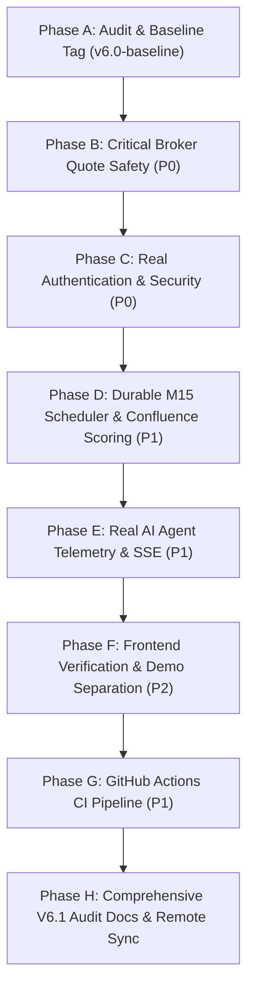

# ZYROX AI V6.1 — IMPLEMENTATION PLAN & ARCHITECTURE BLUEPRINT

**Product:** ZYROX AI — Intelligence Beyond The Market  
**Version:** 6.1.0-PROD  
**Target Branch:** `main`  
**Founder:** HENG TAIKRY  
**Date:** 2026-11-17  
**Status:** IN_PROGRESS  

---

## 1. Executive Summary

This document defines the master execution roadmap for **ZYROX AI V6.1**, building upon the existing codebase and production baseline tag `v6.0-baseline` (`e7735a7`). The objective is to eliminate synthetic assumptions, complete real authentication pathways (Google OAuth 2.0 PKCE and Twilio Phone SMS OTP), enforce broker quote safety with explicit blocker codes, ensure zero-conflict M15 candle scheduling with distributed DB locks, unify the 100-point confluence scoring engine, and deliver real agent telemetry without simulation.

---

## 2. Status Taxonomy

Every subsystem and component in this upgrade adheres to one of five unambiguous statuses:

* `IMPLEMENTED` — Code fully written, integrated into the pipeline, and active.
* `VERIFIED` — Automated unit/integration tests passed, live runtime validated.
* `PARTIALLY_IMPLEMENTED` — Scaffold exists but requires logic completion or wiring.
* `BLOCKED` — Depends on external credentials or infrastructure not yet configured in environment.
* `NOT_IMPLEMENTED` — Scheduled for execution in a subsequent phase.

---

## 3. Phased Implementation Roadmap



---

## 4. Phase Breakdown & Deliverables

### Phase A — Repository Audit & Baseline Lock
* **Status:** `VERIFIED`
* **Deliverables:**
  * Git working tree inspected and clean at commit `e7735a7`.
  * Safety tag created: `v6.0-baseline`.
  * `docs/V61_REPOSITORY_AUDIT.md` generated documenting existing systems and gaps.

### Phase B — Critical Broker Quote Safety (P0)
* **Status:** `IN_PROGRESS`
* **Target Files:**
  * `taikry/trading/xauusd_signal_engine.py`
  * `taikry/data/providers.py`
* **Requirements:**
  1. Primary and only actionable market: **XAUUSD Gold**.
  2. Primary broker: **Exness MT5 bridge** (`MT5BridgePriceProvider`).
  3. Classifications: `REAL_BROKER_QUOTE`, `REFERENCE_PRICE`, `ESTIMATED_SPREAD`, `STALE`, `DISCONNECTED`, `UNAVAILABLE`.
  4. **Delete lines 1101-1107** in `xauusd_signal_engine.py` where synthetic `spread_est = 0.25` is constructed.
  5. Actionable signals (`BUY` or `SELL`) strictly require `classification == REAL_BROKER_QUOTE` and `is_executable == True`.
  6. Return explicit rejection error codes when criteria are not met:
     * `BLOCKED_NO_EXECUTABLE_QUOTE`
     * `BLOCKED_ESTIMATED_SPREAD`
     * `BLOCKED_REFERENCE_ONLY`
     * `BLOCKED_STALE_FEED`
     * `BLOCKED_DISCONNECTED_FEED`

### Phase C — Real Authentication & Security (P0)
* **Status:** `IN_PROGRESS`
* **Target Files:**
  * `taikry/saas/google_oauth.py`
  * `taikry/saas/phone_otp.py`
  * `taikry/api/saas_routes.py`
  * `src/components/AuthModal.tsx`
  * `taikry/web/landing.html`
* **Requirements:**
  1. **Google OAuth 2.0 PKCE / Authorization Code Flow:**
     * State and PKCE code challenge generation with 10-minute expiry.
     * Exchange code for tokens at `https://oauth2.googleapis.com/token`.
     * Validate Google ID token via Google JWKS (`https://www.googleapis.com/oauth2/v3/certs`).
     * Verify audience (`GOOGLE_CLIENT_ID`), issuer (`accounts.google.com` or `https://accounts.google.com`), and expiration.
     * Link/create SaaS user, provision 14-day Pro trial on new registration, issue 30-day `zyrox_session` cookie.
     * If `GOOGLE_CLIENT_ID` or `GOOGLE_CLIENT_SECRET` is unset, return `NEEDS_CONFIGURATION` with instructions.
  2. **Phone SMS OTP:**
     * E.164 normalization and format check (`^\+[1-9]\d{7,14}$`).
     * Cryptographically secure 6-digit OTP generation using `secrets.randbelow`.
     * Salted SHA-256 storage with 5-minute expiry, max 5 attempts, and 60s cooldown.
     * Rate limiting: max 3 requests/hour per phone, max 5 requests/hour per client IP.
     * Real Twilio SMS integration (`TWILIO_ACCOUNT_SID`, `TWILIO_AUTH_TOKEN`, `TWILIO_PHONE_NUMBER`).
     * Never log or expose raw OTP codes in API responses or logs.
     * If Twilio credentials are unset, return `NEEDS_CONFIGURATION` gracefully.

### Phase D — Durable M15 Scheduler & Confluence Scoring (P1)
* **Status:** `IN_PROGRESS`
* **Target Files:**
  * `taikry/monitoring/engine.py`
  * `taikry/trading/confluence_scorer.py`
  * `taikry/notifications/telegram_service.py`
* **Requirements:**
  1. **M15 Candle Scheduler:**
     * Triggers strictly on completed 15-minute candle boundaries (:00, :15, :30, :45 UTC).
     * Single-flight execution enforced via database-backed distributed lock (`scheduler_m15_lock` in `SystemSetting`).
     * Heartbeat recorded: `last_candle_analyzed`, `last_heartbeat_utc`, `status`.
  2. **Unified Confluence Scoring (Target 100 Points):**
     * 8 Confluence Dimensions:
       * Trend (15 pts)
       * Multi-Timeframe Alignment (15 pts)
       * Market Structure (15 pts)
       * SMC / ICT Imbalance (15 pts)
       * Momentum & Oscillators (10 pts)
       * Volume & Volatility (10 pts)
       * News & Macro Filter (10 pts)
       * Risk/Reward & Execution (10 pts)
     * Actionable threshold: Minimum 75/100 for `BUY` and `SELL`.
     * Decisions: `WAIT`, `HOLD`, `BUY`, `SELL`.
     * **Eliminate conflicting `80 <= score <= 95` filters** across `engine.py` and `telegram_service.py`.
  3. **Telegram Integrity:**
     * Daily limit of maximum 4 new actionable BUY/SELL signals per Cambodia calendar day (`Asia/Phnom_Penh`).
     * Persistent deduplication database surviving server restarts.
     * Informational cycle reports never increment the actionable signal counter.

### Phase E — Real AI Agent Telemetry (P1)
* **Status:** `IN_PROGRESS`
* **Target Files:**
  * `taikry/agents/registry.py`
  * `taikry/api/routes.py`
  * `src/sections/AgentsSection.tsx`
* **Requirements:**
  1. Remove all synthetic setTimeout delays and fabricated 96.4% confidence constants.
  2. Stream real agent lifecycle events: `started`, `thinking`, `completed`, `failed`.
  3. Report actual latency, model identifier, and real reasoning summary.

### Phase F — Frontend Verification & Live/Demo Separation (P2)
* **Status:** `IN_PROGRESS`
* **Target Files:**
  * `src/sections/AgentsSection.tsx`
  * `src/data/signals.ts`
  * `src/components/AuthModal.tsx`
  * `taikry/web/index.html`
  * `taikry/web/app.js`
* **Requirements:**
  1. Clearly separate `LIVE` signals from `DEMO` backtest signals.
  2. Display active quote classification (`REAL_BROKER_QUOTE`, `REFERENCE_ONLY`).
  3. Bulletproof dashboard loader with instant failsafe dismisser.

### Phase G — GitHub Actions CI Pipeline (P1)
* **Status:** `NOT_IMPLEMENTED`
* **Target File:** `.github/workflows/ci.yml`
* **Requirements:**
  1. Run on push to `main` and pull requests.
  2. Execute pytest test suite.
  3. Execute TypeScript typecheck and Vite build (`npm run build`).

### Phase H — Audit Documentation & Remote Sync
* **Status:** `IN_PROGRESS`
* **Target Files:**
  * `docs/V61_REPOSITORY_AUDIT.md` (Created)
  * `docs/V61_IMPLEMENTATION_PLAN.md` (Created)
  * `docs/V61_SECURITY_AUDIT.md`
  * `docs/V61_MARKET_DATA_SAFETY.md`
  * `docs/V61_AUTHENTICATION_STATUS.md`
  * `docs/V61_SCHEDULER_STATUS.md`
  * `docs/V61_AI_AGENT_TELEMETRY.md`
  * `docs/V61_TEST_RESULTS.md`
  * `docs/V61_DEPLOYMENT_REPORT.md`
  * `docs/V61_FINAL_REPORT.md`

---

## 5. Rollback Procedure

In the event of an unresolvable failure or production emergency:
1. Revert Git working tree to baseline tag:
   ```bash
   git checkout v6.0-baseline
   ```
2. Re-verify tests pass on clean baseline.
3. Deploy baseline commit `e7735a7` to remotes.
