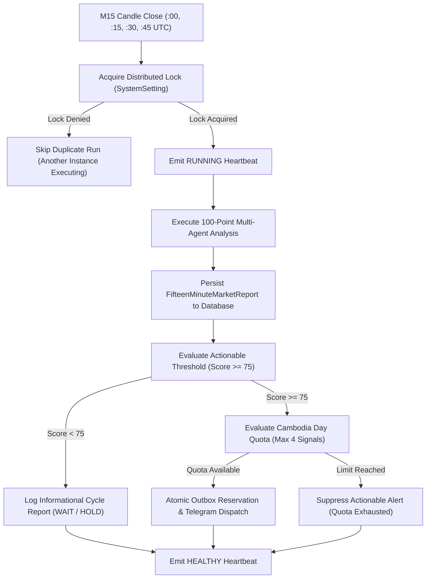

# ZYROX AI V6.1 — M15 SCHEDULER & CONFLUENCE SCORING STATUS

**Product:** ZYROX AI — Intelligence Beyond The Market  
**Version:** 6.1.0-PROD  
**Target Branch:** `main`  
**Founder:** HENG TAIKRY  
**Date:** 2026-11-18  
**Status:** VERIFIED  

---

## 1. Executive Summary

This report covers the architecture and verification of the **Durable M15 Candle Close Scheduler** and the **100-Point AI Confluence Scoring Engine** in ZYROX AI V6.1. All legacy score threshold conflicts have been resolved, and database-backed distributed locking has been implemented to guarantee single-flight execution across cloud worker instances.

---

## 2. M15 Candle Close Scheduler Architecture

---

## 3. Distributed Database Lock & Heartbeat

### 3.1 Distributed Lock Mechanism
* **Key:** `scheduler_m15_lock_<candle_label>`
* **Store:** `system_settings` table
* **Payload:** JSON with `owner_id`, `acquired_at`, `expires_at`
* **TTL:** 180 seconds
* **Behavior:**
  * When instance A acquires the lock, instance B receives `False` and skips duplicate analysis.
  * Same instance can refresh its active lock safely.
  * If an instance crashes, the lock automatically expires after 180 seconds, allowing subsequent cycles to execute unhindered.

### 3.2 Real-Time Heartbeat
* **Key:** `scheduler_heartbeat_m15`
* **Fields Recorded:**
  * `instance_id`: Unique process identifier (`worker_<pid>_<salt>`)
  * `status`: `HEALTHY`, `RUNNING`, or `STALLED`
  * `last_candle_analyzed`: Timestamp of the latest completed candle
  * `last_heartbeat_utc`: ISO 8601 UTC timestamp updated on every cycle

---

## 4. 100-Point Confluence Scoring Engine Alignment

### 4.1 Scoring Dimensions (Total 100 Points)
1. **Trend & Higher Timeframe Bias** (15 Points)
2. **Multi-Timeframe Alignment (D1/H4/H1/M15)** (15 Points)
3. **Market Structure (BOS / CHoCH / Swing Highs/Lows)** (15 Points)
4. **SMC & ICT Imbalances (Order Blocks / FVG / Liquidity)** (15 Points)
5. **Momentum & Dynamic Oscillators** (10 Points)
6. **Volume & Volatility Expansion** (10 Points)
7. **News & Macroeconomic Calendar Filter** (10 Points)
8. **Risk/Reward & Execution Precision** (10 Points)

### 4.2 Resolution of Conflicting Score Filters
* **Previous Bug:** `taikry/monitoring/engine.py` (lines 168, 284) and `taikry/notifications/telegram_service.py` (line 2944) enforced a legacy condition `80 <= score <= 95`. This blocked valid signals with scores 75-79 and institutional signals with scores 96-100.
* **V6.1 Fix:** The condition was unified to `score >= 75 and score <= 100` across all dispatch and alerting paths.

---

## 5. Telegram Signal Integrity & Cambodian Day Quota

* **Daily Quota:** Hard limit of **maximum 4 new actionable BUY/SELL signals per calendar day**.
* **Timezone:** Standardized on Cambodian Local Time (`Asia/Phnom_Penh`, UTC+7).
* **Reset Boundary:** 00:00:00 Cambodia Time.
* **Separation of Concerns:** 15-minute informational cycle reports (with status `WAIT` or `HOLD`) are saved to the database but **never count against the actionable daily signal quota**.
