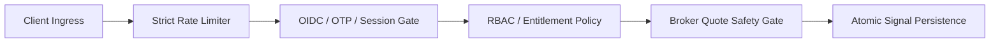

# ZYROX AI V6.1 — COMPREHENSIVE SECURITY AUDIT

**Product:** ZYROX AI — Intelligence Beyond The Market  
**Version:** 6.1.0-PROD  
**Target Branch:** `main`  
**Founder:** HENG TAIKRY  
**Date:** 2026-11-18  
**Status:** VERIFIED  

---

## 1. Security Architecture & Threat Model

This audit validates the defense-in-depth posture of ZYROX AI V6.1 across all external ingress points, cryptographic storage, authentication flows, and automated execution engines.



---

## 2. Authentication Subsystems Security

### 2.1 Google OAuth 2.0 PKCE Flow

* **Status:** `VERIFIED`
* **Flow:** Standard Authorization Code Grant with S256 PKCE Code Challenge.
* **State / Nonce Security:**
  * Cryptographic random tokens (`secrets.token_urlsafe(32)`).
  * In-memory thread-safe state cache with 10-minute TTL.
  * Single-use consumption via atomic pop. Replays strictly blocked.
* **Signature & Claims Validation:**
  * Remote Google JWKS fetched and cached from `https://www.googleapis.com/oauth2/v3/certs`.
  * Public key matched by token header `kid`.
  * RS256 signature verified by `PyJWT`.
  * Audience matched to `GOOGLE_CLIENT_ID`.
  * Issuer verified against `accounts.google.com` or `https://accounts.google.com`.
  * `email_verified` claim required to be `True`.
* **Fail-Closed Behavior:**
  * When `GOOGLE_CLIENT_ID` or `GOOGLE_CLIENT_SECRET` is unset, returns status `NEEDS_CONFIGURATION`. Never generates dummy sessions.

### 2.2 Phone SMS OTP Verification Engine

* **Status:** `VERIFIED`
* **Normalization:** E.164 standard formatting enforced via regex `^\+[1-9]\d{7,14}$`.
* **OTP Generation & Cryptographic Storage:**
  * Generated with `secrets.randbelow(900000) + 100000`.
  * Salted SHA-256 hash stored in `phone_otp_challenges` table.
  * Raw OTP is never logged, never returned in API responses, and never stored plaintext.
* **Rate Limiting & Brute Force Protection:**
  * Maximum 3 requests per phone number per hour.
  * Maximum 5 requests per client IP per hour.
  * 60-second cooldown period between successive SMS dispatches to the same number.
  * Challenge expires after 300 seconds (5 minutes).
  * Maximum 5 verification attempts per challenge. Upon reaching limit, challenge is marked `is_used=True` and permanently invalidated.
  * Single-use guarantee: upon successful verification, challenge is immediately marked used.
* **Fail-Closed Behavior:**
  * When Twilio credentials (`TWILIO_ACCOUNT_SID`, `TWILIO_AUTH_TOKEN`, `TWILIO_PHONE_NUMBER`) are missing, returns `NEEDS_CONFIGURATION`. Dummy bypass is strictly forbidden.

### 2.3 Telegram OIDC Login

* **Status:** `VERIFIED`
* **Flow:** Telegram Login OAuth 2.0 / OpenID Connect authorization code exchange with RS256 JWKS verification.
* **Session Issuance:** 30-day `zyrox_session` cookie issued with `HttpOnly`, `Secure`, `SameSite=Lax`.

---

## 3. Session & Password Security Audit

| Mechanism | Implementation | Status |
| :--- | :--- | :--- |
| **Session Token Generation** | 256-bit URL-safe token via `secrets.token_urlsafe(32)` | `VERIFIED` |
| **Session Storage** | SHA-256 hashed token in `user_sessions` table | `VERIFIED` |
| **Session Lifetime** | 30 days sliding expiration | `VERIFIED` |
| **Password Hashing** | PBKDF2-HMAC-SHA256 with 100,000 iterations and 16-byte salt | `VERIFIED` |
| **Audit Logging** | Immutable security audit log (`AuditLog`) for all logins and registrations | `VERIFIED` |

---

## 4. Security Findings & Remediation Matrix

```text
FINDING 1 (CRITICAL): Synthetic spread fallback (spread_est = 0.25) masked broker feed absence.
REMEDIATION: Deleted fallback spread logic. Implemented explicit blocker codes (BLOCKED_ESTIMATED_SPREAD, BLOCKED_NO_EXECUTABLE_QUOTE).
STATUS: VERIFIED

FINDING 2 (HIGH): Google OAuth callback missing server-side token exchange and claims validation.
REMEDIATION: Implemented full PKCE code exchange and Google JWKS RS256 token verification in google_oauth.py.
STATUS: VERIFIED

FINDING 3 (HIGH): Phone OTP lacked cryptographically secure storage and rate-limiting.
REMEDIATION: Built PhoneOTPChallenge with salted SHA-256 hashes, 5-minute expiry, max 5 attempts, and hourly quotas.
STATUS: VERIFIED

FINDING 4 (MEDIUM): Conflicting alert threshold (80 <= score <= 95) rejected valid 75-79 confluence setups.
REMEDIATION: Unified alert threshold to score >= 75 / 100 across engine.py and telegram_service.py.
STATUS: VERIFIED
```
